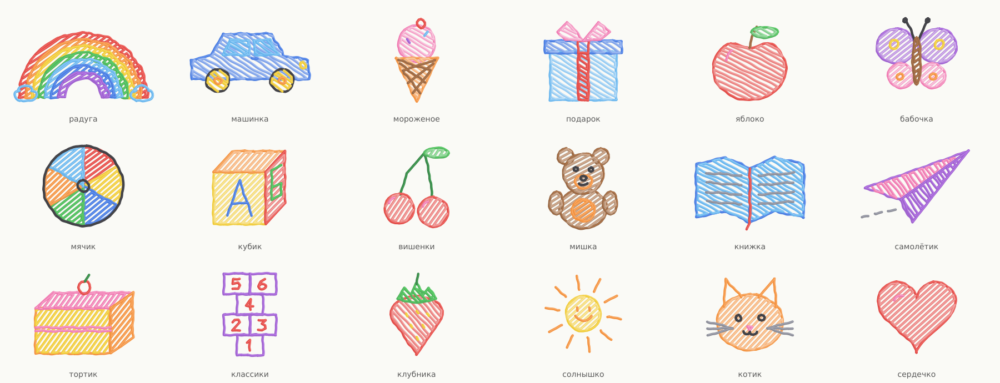
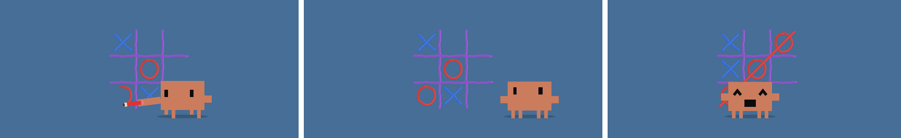
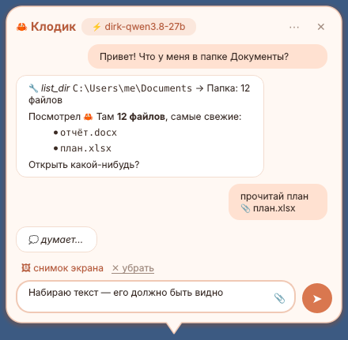

# Klodik 🦀

**Пиксельный краб-питомец для рабочего стола Windows с локальным ИИ.**

Клодик живёт внизу экрана: гуляет по окнам, прыгает, рисует мелками на обоях, толкает иконки,
строит из них домики и иногда предлагает сыграть в крестики-нолики. А ещё с ним можно поговорить:
его «мозг» — языковая модель, которая работает прямо на вашей видеокарте через LM Studio.
Ничего не уходит в облако.

## Что умеет

- **Живёт на рабочем столе.** Гуляет, прыгает по окнам, спит, читает, «кодит» на ноутбуке. Работает на двух мониторах.
- **Рисует мелками.** 29 цветных рисунков и надписи: радуга, машинка, мишка, котик, тортик и другие, со штриховкой как у ребёнка. Рисунки остаются на обоях, пока их не стереть.
- **Играет в крестики-нолики.** Рисует поле, вы кликаете по клеткам, он отвечает ноликами. Иногда поддаётся.
- **Двигает иконки** по одной и строит из них домики. Потом может вернуть всё на место.
- **Чат в облачке.** Клик по крабу — и пишете ему прямо в облачко. История, вложения (PDF, Word, Excel, картинки), библиотека промптов.
- **Видит экран** (по желанию) и комментирует, что происходит. Когда открыт банк или менеджер паролей (список можно менять), он не смотрит.
- **Агент:** читает файлы и папки, ищет в интернете, а записывать файлы и запускать команды может только после вашей кнопки «Разрешить».
- **Бережёт видеопамять:** держит в памяти только одну модель, а кнопка «Выключить ИИ» выгружает всё.
- **Дружит с Claude Code:** если подключить хуки, радуется, когда Claude Code закончил задачу.

## Установка

### Просто запустить
1. Скачайте `Klodik.exe` из раздела [Releases](../../releases).
2. Запустите. Если Windows покажет «Windows защитила ваш компьютер», нажмите «Подробнее» → «Выполнить в любом случае»: так бывает с программами без цифровой подписи.
3. Краб появится внизу экрана. Правый клик по нему открывает меню.

### Собрать из исходников
1. Установите [Python 3.10+](https://www.python.org/downloads/) с галочкой «Add python.exe to PATH».
2. Скачайте репозиторий (Code → Download ZIP) и распакуйте.
3. Запустите `INSTALL.bat`. Он соберёт `Klodik.exe`, положит его в `%LOCALAPPDATA%\Programs\Klodik`, сделает ярлык на рабочем столе и запустит краба.

Только собрать exe без установки: `build.bat`, результат в `dist\Klodik.exe`.

## Чат и зрение (LM Studio)

1. Установите [LM Studio](https://lmstudio.ai) и скачайте модели, например:
   - `qwen/qwen3.5-9b` — основная, для чата (~6,5 ГБ);
   - `qwen/qwen3.5-4b` — лёгкая, для зрения (~3,4 ГБ).
   На слабой видеокарте хватит одной 4B.
2. В LM Studio включите сервер: вкладка **Developer → Start Server** (`http://localhost:1234`).
3. Правый клик по крабу → **Настройки ИИ…** → выберите модели.

Ollama тоже подходит.

## Где что лежит

- Настройки, рисунки, память и история чатов: `%APPDATA%\Klodik`.
- Журнал ошибок: `%APPDATA%\Klodik\error.log`.
- Если раньше стоял Claude Pet, Klodik сам перенесёт его настройки и рисунки при первом запуске.

## Поддержать проект

Klodik бесплатный и останется бесплатным. Если он вам нравится:

- ⭐ поставьте звезду этому репозиторию — кнопка **Star** вверху страницы;
- 📣 подпишитесь на Телеграм-канал [t.me/ArtEmotion3DGroup](https://t.me/ArtEmotion3DGroup) — там новости, а поддержать автора можно звёздами Telegram.

## Авторы

- [bys220277-sudo](https://github.com/bys220277-sudo) — автор.
- [Tm04ka](https://github.com/Tm04ka) — соавтор: рисунки мелками, анимации, реакции на систему и Claude Code.

Лицензия: [MIT](LICENSE).

---

Klodik — фанатский проект. Он не связан с Anthropic и не одобрен ею.
Claude и Claude Code — товарные знаки Anthropic.
